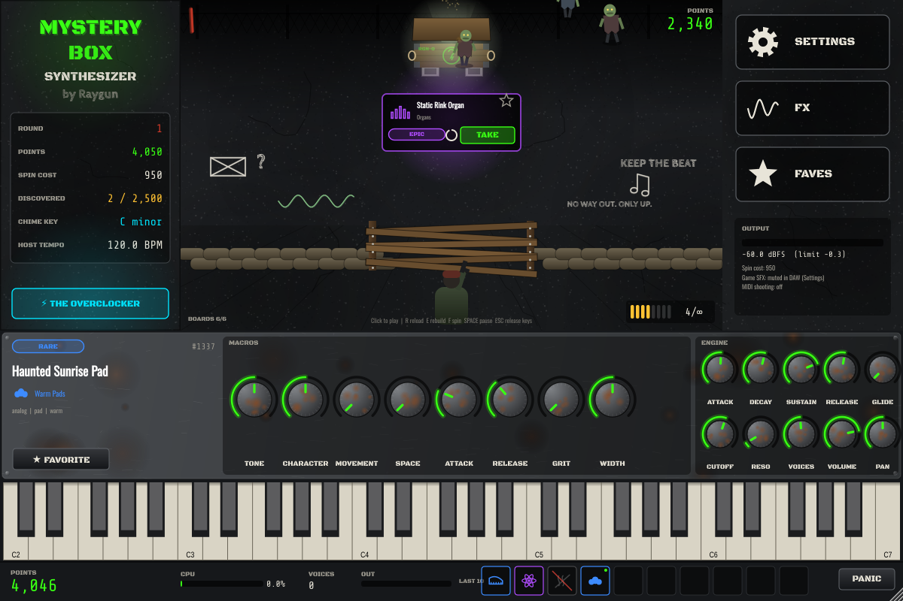

# Mystery Box Synthesizer — by Raygun

A polyphonic hybrid synthesizer (VST3 / AU / Standalone) with a twist: you **win your instruments**.
Survive waves of zombies in the built-in mini-game to earn points, spend them on the **Mystery Box**,
and it spins through **2,500 original instruments** before landing on one. Take it, and it's yours.



Title + secrets (top-left) · Game view (top-centre) · Settings / FX / Favorites (top-right) ·
Instrument panel (middle) · Keyboard, points, CPU and your last 10 box results (bottom).

---

## Features

- **Hybrid synthesis engine** — per voice: 3 oscillators, each Virtual-Analog (PolyBLEP saw/pulse/tri/sine + PWM),
  Wavetable (64 original procedurally generated tables × 8 morph frames, band-limited mip-maps), 2-operator FM,
  Karplus-Strong pluck, modal resonator bank (bell/marimba/vibes/glass/kalimba/gong), waveguide (blown reed / bowed string)
  or additive (up to 32 partials). Plus noise (white/pink/brown, filtered, decaying), sub oscillator, unison up to 8
  with detune + stereo spread.
- **Filters**: zero-delay-feedback ladder (12/24 dB) with saturation, TPT state-variable (LP/HP/BP/notch), vowel
  formant, tuned comb. Two filters, serial or parallel.
- **Modulation**: 3 ADSRs with curve control, 2 tempo-syncable LFOs (sine/tri/saw/square/S&H/smooth random, fade-in),
  8-slot mod matrix (LFOs, envelopes, velocity, mod wheel, aftertouch, key track, random, MPE slide, macros → 35 destinations).
- **8 macros per instrument** (Tone, Character, Movement, Space, Attack, Release, Grit, Width), all host-automatable,
  plus the secret **Overclocked** macro.
- **Polyphony** up to 32 voices, voice stealing (oldest / quietest / released-first), mono + legato + glide, **MPE**.
- **FX chain** (drag to reorder): Drive (tape/tube/hard, optional 2× oversampling), Bitcrusher, Chorus/Ensemble,
  Phaser, Flanger, Stereo Delay (tempo-synced, ping-pong, filtered feedback), FDN Reverb (Hall / Room / Plate /
  **Bunker** / **Asylum**), 3-band EQ, Compressor — and an **always-on −0.3 dBFS safety limiter**.
  Optional **Round Ambience**: synthesized distant wind and groans under your sound.
- **Favorites & collection tracker** — star anything you've won, load it any time for free, search/filter/sort,
  "Discovered N / 2,500" grid, import/export `.mbxfav`. Stored globally (all projects, all DAWs).
- Every sound effect is **synthesized in code**; all art is **drawn in code**. No samples, no bitmap assets.

## How to play — "Survive to Spin"

Click the game view to give it keyboard focus (DAW shortcuts work normally whenever it isn't focused).

| Control | Action |
|---|---|
| Mouse | Aim (custom crosshair) |
| Left click | Shoot · click the box to spin · click **TAKE** · click power-ups to grab them |
| **R** | Reload (8-round pistol, infinite reserve) |
| **E** (hold) | Rebuild barricade boards (+10 each) |
| **F** | Open the Mystery Box |
| **Space** | Pause / resume (the game loop stops completely while paused) |
| **Esc** | Release keyboard focus back to the DAW |
| MIDI notes | With *MIDI shooting mode* on, every note-on fires at the nearest zombie — velocity = damage |

Zombies shamble in from the dark toward your barricade (6 boards). Walkers from round 1, **Runners** from round 5,
**Brutes** from round 10, **Crawlers** from round 15. If they break through and reach you, you go down — the game
returns to round 1 but **you keep your points**. Kills have a 3% chance to drop a power-up: **Double Points** (30 s),
**Insta-Kill** (30 s), **Max Ammo**, **Nuke** (+400).

### Points

| Action | Points |
|---|---|
| Hit on zombie | +10 |
| Kill (body) | +60 |
| Kill (headshot / critical zone) | +100 |
| Rebuild board | +10 |
| Round completed | +50 × round number |

The box costs **950** points (250 / 500 / 950 / 1,500 in Settings). **Free Spin / practice mode** makes it free.

### The Mystery Box

The lid creaks open, instruments cycle above it (fast, then slowing) with a music-box chime on every tick — pitched to
the key you've been playing (C minor by default) — and it lands. Click **TAKE** within 8 seconds or it sinks back into
the box and is lost. A short preview phrase plays (standalone always; in a DAW only while the transport is stopped).
The box never repeats any of your last 20 results, and the RNG state is saved in your project — reloading a project
can't be used for a free re-roll.

| Rarity | Odds |
|---|---|
| Common (grey) | 60 % |
| Rare (blue) | 25 % |
| Epic (purple) | 11 % |
| Legendary (gold) | 3.5 % |
| **Wonder** (pulsing cyan, special ray sound) | 0.5 % — only from the *Wonder Weapons* category |

After your 5th spin each spin has a 1-in-15 chance of summoning **Clank**, the tin-can robot, who laughs and carries the
box off to a new spot. That spin is refunded. (Can be disabled.)

### Easter egg

*Some names hide more than they say…*

## The 2,500 instruments

25 categories × 100: Grand & Upright Pianos · Electric Pianos · Organs · Mallets & Bells · Plucked Strings ·
Bowed Strings · Brass · Woodwinds · Analog Leads · Digital Leads · Mono Basses · Sub & 808 Basses · Reese & Wobble
Basses · Warm Pads · Dark & Horror Pads · Evolving Textures · Plucks & Keys · Arps & Sequencer-ready · Choirs & Vocal
Formants · World Instruments · Chiptune / 8-bit · Synth Brass & Stabs · FX & Risers · Cinematic Hits & Drones ·
**Wonder Weapons**.

They are generated by `tools/generate_presets.py` from hand-designed archetypes per category (e.g. "felt upright",
"tine EP", "drawbar organ", "acid bass", "wobble", "tritone horror pad", "sitar", "ray gun") with controlled
randomisation; higher rarities get richer modulation and layering. **Every preset is then rendered through the real
engine by `tools/validate_presets.cpp`**, which rejects presets that are silent, non-finite, clip excessively, carry DC
offset, fail to decay after release, blow up at extreme notes or in chords, and loudness-matches the rest (−18 dBFS RMS
target, peak ≤ −4.5 dBFS over several note-ons, so velocity-127 notes stay below −1 dBFS). Rejected presets are
regenerated until all 2,500 pass. The final library is a 1.8 MB binary blob embedded in the plugin; the full parse takes
a few milliseconds.

## Build from source

Requirements: CMake ≥ 3.22, a C++20 compiler, git. JUCE 8 (8.0.17) and Catch2 are fetched automatically
(or pass `-DMBX_JUCE_DIR=…` / `-DMBX_CATCH2_DIR=…` for offline builds).

```bash
scripts/build_mac.sh            # macOS: Universal VST3 + AU + Standalone, runs tests (--install to install)
```

```powershell
powershell -ExecutionPolicy Bypass -File scripts\build_windows.ps1    # Windows x64: VST3 + Standalone, runs tests
```

```bash
cmake -S . -B build -G Ninja -DCMAKE_BUILD_TYPE=Release && cmake --build build   # Linux (bonus): VST3 + Standalone
```

**GitHub Actions** (`.github/workflows/build.yml`) builds macOS (universal), Windows and Linux, runs the unit tests, the
plugin-level tests, **pluginval at strictness 10** (VST3 + AU), **`auval -v aumu MbxS Rygn`**, a headless host smoke
test of the built VST3, optional code signing / notarization (repository secrets `APPLE_DEVELOPER_ID`, `APPLE_TEAM_ID`,
`APPLE_ID`, `APPLE_APP_PASSWORD`, `APPLE_CERT_P12_BASE64`, `APPLE_CERT_PASSWORD`; Windows `WIN_CERT_PFX_BASE64`,
`WIN_CERT_PASSWORD`), builds the `.pkg` and Inno Setup installers and assembles `MysteryBoxSynth_by_Raygun_v1.0.0.zip`
(uploaded as an artifact, and attached to a GitHub Release for `v*` tags).

Regenerating the instrument library:

```bash
python3 tools/generate_presets.py --validator build/mbx_validate_presets --out Resources/presets.bin
```

### Tests

- `mbx_tests` (Catch2, 23 cases): PolyBLEP / wavetable aliasing, filter stability at extreme settings, envelope timing,
  limiter ceiling, FX stability in every order, voice allocation / stealing / mono-legato / sustain / MPE / crossfaded
  preset swaps, all sample rates and odd block sizes, every SFX, **rarity distribution within 1 % over 1,000,000 spins**,
  no-duplicate rule over 200,000 spins, mascot odds, RNG state round-trip, library integrity, and **audio validation
  of all 2,500 presets**.
- `mbx_plugin_tests`: processor state round-trip (instrument, points, round, RNG, inventory, FX order, macros),
  output ceiling, real-time allocation tracker (Debug builds), all presets through the processor, CPU measurement,
  **20-instance stress test** (random MIDI, macro automation, rapid preset switching), editor snapshots.
- `mbx_host_check`: loads the **built .vst3** through JUCE's VST3 hosting, 44.1–192 kHz × 16–4096-sample blocks,
  state round-trip, instantiation and editor-open times.

## System requirements

- macOS 11 or later, Apple Silicon or Intel (Universal). VST3 / AU / Standalone.
- Windows 10 or later, x64. VST3 / Standalone.
- (Bonus) Linux x64 with X11: VST3 / Standalone.
- Any host supporting VST3 or AU instruments. OpenGL 2.1+ for GPU rendering of the game view (can be turned off).

## Measured performance (Linux x64 cloud vCPU, Release build)

| Measurement | Result | Target |
|---|---|---|
| Typical preset, 8 voices, 48 kHz / 256 | 2.8 – 4.7 % of one core (avg 4.0 %) | < 3 % on an M1 |
| 20 instances, random MIDI + automation + preset switching | 6.5 % of one core per instance | no glitches |
| Plugin instantiation (built VST3) | 14 – 48 ms | < 150 ms |
| Editor open | 44 ms | < 300 ms |
| Preset load (incl. one audio block) | 0.05 ms | < 5 ms |

The container CPU is slower per core than an M1, so the 8-voice figure is expected to land at or below the target on
Apple Silicon. That has **not** been measured here.

## Design decisions

- **Engine is plain C++20 (no JUCE)** so the plugin, unit tests and the offline preset validator run exactly the same
  DSP code. JUCE is used for the plugin wrapper, parameters, UI and hosting.
- **Instruments are parameter presets, not samples** (as specified). Wavetables are generated procedurally at load on a
  background thread (~100 ms) instead of being stored, keeping the binary small; the wavetable oscillator is silent
  for that first fraction of a second after the very first instance loads.
- **Points live in the project** (saved with `getStateInformation`), so every project is its own game; lifetime points,
  spins, the discovered collection, favourites and Easter-egg flags are **global** (user settings file with an
  inter-process lock, merged on save, re-read when another instance changes it).
- **Discovery** happens when the box *lands* on an instrument, even if you don't take it. Favourites can only contain
  discovered instruments, and loading a favourite (or a taken item from the last-10 strip) is free.
- **Game SFX** are synthesized on the audio thread from lock-free triggers but are **muted in a DAW by default** (as
  specified); they're audible in the standalone app or with *Send game SFX to plugin output*. The Easter-egg sting
  follows the same rule. The **spin preview** is the instrument itself, so it plays in a DAW too, but only while the
  transport is stopped, so it never lands in a recording.
- **"Chime follows DAW key"**: hosts don't expose a song key, so the chime key is detected from the MIDI you play
  (Krumhansl-Schmuckler key finding over a decaying pitch-class histogram); C minor until enough notes are heard.
- **Preset swap** happens on the audio thread from a preset *index* sent through a lock-free FIFO (the library is
  immutable after load, so no allocation or pointer ownership crosses threads): 5 ms fade-out, swap, held notes are
  re-triggered, 5 ms fade-in (10 ms total, click-free).
- **Host parameters**: macros, Overclocked, amp ADSR, cutoff, resonance, glide, voices, volume, pan and every FX
  parameter are automatable. Loading an instrument writes its macro/ADSR/filter defaults (and, if *FX follow
  instrument* is on, its suggested reverb/delay/chorus) into those parameters. Restoring a project restores your
  tweaks, not the defaults.
- **Overclocker** upgrades apply to the current instrument (saved with the project) and reset when a different
  instrument is loaded.
- **Oversampling** (Settings) applies 2× oversampling to the non-linear drive stages (voice drive and the Drive FX).
  The ladder filter uses a ZDF structure with a cubic soft clip and is not oversampled.
- **SIMD**: the hot loops are written for auto-vectorisation and instruction-level parallelism (stereo filter pairs
  processed in one interleaved loop, block-rate modulation, branch-free inner loops) rather than with explicit
  `SIMDRegister` code, which keeps the engine portable across x64/arm64/MSVC/Clang/GCC.
- **Wonder rarity** pulls only from the *Wonder Weapons* category. That category holds 50 Wonder, 20 Legendary and
  30 Epic instruments; the other 24 categories are 62/26/9/3 Common/Rare/Epic/Legendary. Odds are per tier, so pool
  sizes don't change the published odds.
- **Editor scaling**: the UI is laid out at 1200×800 and scaled with one transform (crisp vector rendering at any size,
  static layers cached at the display's physical pixel density). Aspect ratio is locked; 900×600 to 2400×1600.
- **Game rendering** uses an attached `juce::OpenGLContext` (component painting on the GPU), switchable off in
  Settings as a fallback for hosts with OpenGL problems. The game loop runs on a message-thread timer and stops
  completely when the editor is hidden, closed or the game is paused.

## Smoke-test status by host

| Host | Status |
|---|---|
| Headless JUCE VST3 host (`mbx_host_check`, Linux) | ✅ passed (this build) |
| pluginval strictness 10 (VST3 + AU), auval | ⏳ runs in CI on push. Could not be run in the build container (downloading the pluginval binary was not permitted there) |
| Ableton Live, FL Studio, Logic Pro, Reaper, Studio One, Bitwig, Cubase | ⏳ not yet tested. Please report results |

## Credits

Design, engine, instruments, game, art and sound effects: **Raygun**. Built with JUCE. Fonts under the SIL OFL
(see `Resources/fonts`). See `LICENSE_NOTES.md`.
